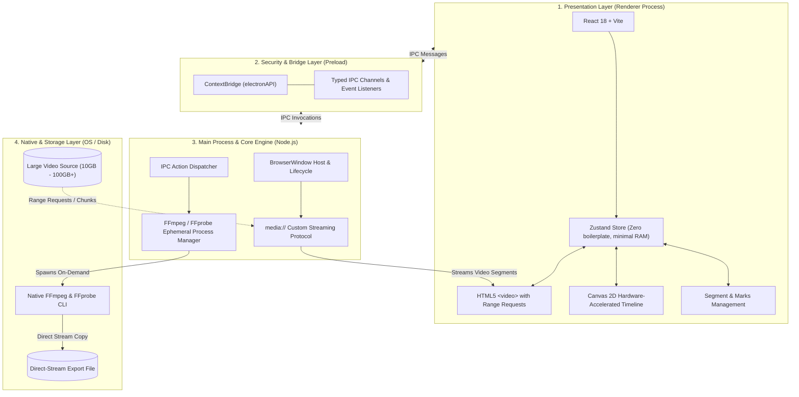
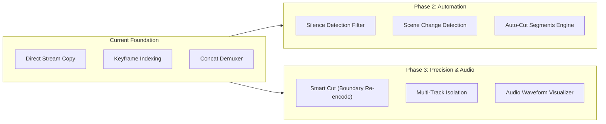

# ClippyCut: Architecture & Technical Design Document
**Fast, Low-RAM Direct-Stream Video Editor for Large Files (10 GB – 100 GB+)**

---

## 1. Executive Summary

ClippyCut is a desktop video editor designed to process massive video files (such as 4K OBS screen captures, raw gameplay streams, DSLR/drone footage, and GoPro recordings) with near-instantaneous export speeds and minimal memory overhead.

Traditional non-linear editors (NLEs) decode raw frames into system memory and require full re-encoding upon export, creating bottlenecks in RAM usage, CPU/GPU temperature, and processing time. ClippyCut operates at the bitstream packet layer using **FFmpeg Direct Stream Copying (`-c copy`)**.

---

## 2. High-Level System Architecture

The application is structured into four decoupled layers:



---

## 3. Core Architectural Mechanisms for Low RAM Usage

Editing large files on consumer machines often leads to Out-Of-Memory (OOM) errors or system freezing. ClippyCut addresses this with five core constraints:

| Technique | Traditional Editor Problem | ClippyCut Solution | RAM Impact |
| :--- | :--- | :--- | :--- |
| **Media Loading** | Loads entire files or gigabyte frame caches into memory. | Custom `media://` scheme supporting HTTP 206 Partial Content (range requests). Streams directly from disk. | **Under 150 MB** RAM regardless of file size (1 GB vs 100 GB). |
| **Process Lifespan** | Long-running native daemons or background workers with memory leaks. | **Ephemeral child processes**: `ffmpeg` and `ffprobe` spawn only during an action, stream small chunks to stdout, and exit immediately. | Zero persistent background RAM usage. |
| **Timeline Scrubbing** | Thousands of HTML DOM nodes (`div`s for ticks, segments, waveforms). | Single `<canvas>` rendered on demand via `requestAnimationFrame`. | Constant ~2 MB canvas buffer instead of hundreds of megabytes of DOM nodes. |
| **State Management** | Heavy frameworks with deep object cloning and history trees (Redux/MobX). | **Zustand** store: flat, subscription-based, no middleware bloat. | < 1 MB memory footprint. |
| **Background Throttling** | Unfocused tabs/windows continue high-frequency polling. | Electron `backgroundThrottling: true` reduces timer intervals and GC pressure when unfocused. | Idle CPU drops to ~0%, freeing RAM for other OS tasks. |

---

## 4. Media Processing Pipeline

### 4.1. Fast Probe & Keyframe Indexing
1. When a file is dropped or opened, `ffprobe` extracts container metadata (duration, format, audio/video stream parameters) as compact JSON:
   ```bash
   ffprobe -v quiet -print_format json -show_format -show_streams <input>
   ```
2. In the background (without blocking the UI), keyframe timestamps are indexed:
   ```bash
   ffprobe -v quiet -select_streams v:0 -skip_frame nokey -show_entries frame=pkt_pts_time -of csv=p=0 <input>
   ```
3. These keyframe timestamps are marked on the canvas timeline to allow clean cutting boundaries.

### 4.2. Direct Stream Cutting (Zero Re-encoding)
Modern video codecs (H.264, HEVC, AV1) compress video into **Groups of Pictures (GOPs)** starting with an intra-coded frame (**I-frame / Keyframe**). Slicing video at keyframe boundaries allows pure packet copying:

```bash
ffmpeg -y -ss <start> -to <end> -i <input> -c copy -map 0 -avoid_negative_ts make_zero <output_segment>
```
* `-c copy`: Disables decoders and encoders; copies raw bitstream packets.
* `-map 0`: Preserves all audio tracks, subtitles, and metadata.
* `-avoid_negative_ts make_zero`: Resets presentation timestamps (PTS) to start cleanly at 0.

### 4.3. Multi-Segment Joining (Concat Demuxer)
When merging multiple cut segments, ClippyCut generates an in-memory or temporary concat manifest:
```text
file 'segment1.mp4'
file 'segment2.mp4'
```
And passes it to FFmpeg's concat demuxer:
```bash
ffmpeg -y -f concat -safe 0 -i _concat_list.txt -c copy <merged_output>
```
Export speed is bounded solely by disk storage throughput (NVMe / SSD), completing multi-gigabyte exports in seconds.

---

## 5. Project Directory & Component Structure

```
d:\Playground\video-editor\
├── package.json               # Node dependencies & build scripts
├── electron.vite.config.ts    # Dual-target bundler configuration (main & renderer)
├── tsconfig.json              # TypeScript workspace reference
├── tsconfig.node.json         # TypeScript config for Electron Main & Preload
├── tsconfig.web.json          # TypeScript config for React Web Renderer
├── README.md                  # Quickstart & user documentation
├── ARCHITECTURE.md            # System architecture specification
│
└── src/
    ├── common/
    │   └── types.ts           # Shared data contracts (MediaInfo, Segment, Keyframe)
    │
    ├── main/
    │   ├── index.ts           # App lifecycle, window management, media:// protocol
    │   ├── ffmpeg.ts          # Process spawner & FFmpeg CLI automation routines
    │   └── ipc-handlers.ts    # IPC handlers for dialogs, probe, export, and thumbnails
    │
    ├── preload/
    │   └── index.ts           # Context isolation bridge exposing safe electronAPI
    │
    └── renderer/
        ├── index.html         # Webview host page with Content Security Policy
        └── src/
            ├── main.tsx       # React 18 initialization
            ├── App.tsx        # Shell layout, keyboard hotkeys & drag-and-drop
            ├── App.css        # Dark theme UI styling
            ├── env.d.ts       # Typed Electron window interface
            ├── store/
            │   └── editorStore.ts  # Zustand reactive state store
            └── components/
                ├── Toolbar.tsx     # Open file, export progress, media summary
                ├── VideoPlayer.tsx # HTML5 video element bound to media://
                ├── Timeline.tsx    # Hardware-accelerated 2D canvas timeline
                ├── Controls.tsx    # Scrubbing, step frames, keyframe snapping, in/out marks
                └── SegmentList.tsx # List of marked segments with color coding
```

---

## 6. Implementation Strategy for Future Capabilities

The decoupled design enables straightforward implementation of the planned future features:



### 6.1. Auto-Cutting (Silence & Dead-Air Removal)
* **Mechanism:** Execute FFmpeg's `silencedetect` audio filter on the target audio stream:
  ```bash
  ffmpeg -i input.mp4 -af silencedetect=noise=-30dB:d=0.5 -f null -
  ```
* **Integration:** Parse `silence_start` and `silence_end` timestamps from stderr, compute the inverse (active speaking sections), and populate the Zustand segment list automatically.

### 6.2. Smart Cut (Frame-Accurate Cutting)
* **Mechanism:** When a user sets a cut point that does not land on an I-frame:
  1. Re-encode only the first/last GOP (a fraction of a second) to match the source bitstream parameters.
  2. Stream-copy the middle body (99% of the file).
  3. Concatenate the re-encoded boundary with the stream-copied body.
* **Benefit:** 100% frame accuracy with 98% of the export remaining instantaneous.

### 6.3. Multi-Track Audio Management (OBS Streams)
* **Mechanism:** OBS and professional capture cards record game audio, microphone, and chat on distinct audio tracks (`0:a:0`, `0:a:1`, `0:a:2`).
* **Integration:** Read `streams[]` from `probeFile()`, provide toggle switches in the UI, and map only selected audio streams in the export command (`-map 0:v -map 0:a:1`).

---

## 7. Verification & Operational Guidelines

### Development Mode
```powershell
# Navigate to the workspace
Set-Location d:\Playground\video-editor

# Start the live-reload development server
npm run dev
```

### Production Build
```powershell
# Compile TypeScript and package the distribution bundles
npm run build
```
The output will be placed in `d:\Playground\video-editor\out\`.
